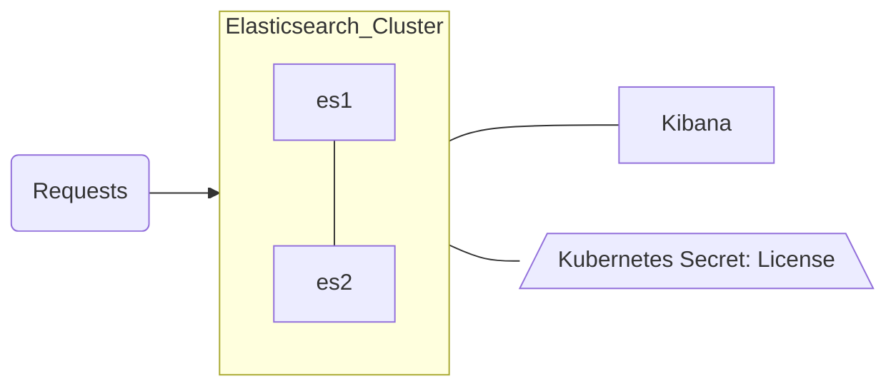

# Search Example

## Base Diagram

## Deployable Assets in this Directory

| Elastic Cluster | Filename |  Resource (Kind) | Count | Features Added |
| :-------------: |:-------------:| :-------------: | :-------------: | :-------------: |
|main|elasticsearch.yml|Elasticsearch|2|[Virtual Memory](https://www.elastic.co/docs/deploy-manage/deploy/cloud-on-k8s/virtual-memory), [Persistent Storage](https://www.elastic.co/docs/deploy-manage/deploy/cloud-on-k8s/volume-claim-templates), [Compute Resources](https://www.elastic.co/docs/deploy-manage/deploy/cloud-on-k8s/manage-compute-resources), [Custom Configuration Files (Synonyms)](https://www.elastic.co/docs/deploy-manage/plugins-and-custom-configuration-files/cloud-on-k8s/custom-configuration-files-plugins), [Elastic Audit Settings](https://www.elastic.co/docs/deploy-manage/monitor/stack-audit-logging/enabling-audit-logs), [Internal Monitoring](https://www.elastic.co/docs/deploy-manage/monitor/stack-monitoring/eck-stack-monitoring)|
|main|kibana.yml|Kibana|1|[Compute Resources](https://www.elastic.co/docs/deploy-manage/deploy/cloud-on-k8s/k8s-kibana-advanced-configuration)|
|main|fleet.yml|[RBAC Roles](https://kubernetes.io/docs/reference/access-authn-authz/rbac/)||Kubernetes RBAC for Agents, Fleet|
|main|synonyms-configmap.yml|configMap||[Custom Configuration Files](https://www.elastic.co/docs/deploy-manage/plugins-and-custom-configuration-files/cloud-on-k8s/custom-configuration-files-plugins)|
|ECK-Wide|trial-license.yml|Secret:[License](https://www.elastic.co/docs/deploy-manage/license/manage-your-license-in-eck)||Trial License to Enable All Features|
|_optional_|fleet.yml|Fleet Server(Agent)|1|[Fleet](https://www.elastic.co/docs/deploy-manage/deploy/cloud-on-k8s/fleet-managed-elastic-agent), [APM Integration](https://www.elastic.co/docs/solutions/observability/apm/switch-to-elastic-apm-integration) |
|_optional_|fleet.yml|[Agents](https://www.elastic.co/docs/deploy-manage/deploy/cloud-on-k8s/configuration-examples-fleet)|1+n|[System](https://www.elastic.co/docs/reference/integrations/system), [Kubernetes](https://www.elastic.co/docs/reference/integrations/kubernetes)|

---

## Search Cluster

We have taken our previous quickstart cluster but made a few additions like persistent storage and a custom synonyms file to make a relatively straightforward 2-3 node Elasticsearch cluster.  The table above should reflect the assets being deployed and documentation references to the added features and settings. You can deploy the yamls in the base directory flat and as is with a normal kubectl command. 

`kubectl apply -f elasticsearch.yml -f kibana.yml -f synonyms-configmap.yml -f trial-license.yml`

However, next to the base directory is the overlay directory which has  `dev` and `prod` subdirectories.  By using a tool called `Kustomize` that is built into every kubectl command line, we can do some simple templating by environment and "overlay" the values appropriately.  The goal is that in lieu of your own preferred strategy, this should be a low dependency method to build out and maintain a core base yaml set with various overlays making changes to say resources, version, or node counts. You are by no means forced to use this and can generate a template and just use the output. 

You can also optionally deploy Agents with Fleet by following the instructions further down the page.

> NOTE: You may also install `Kustomize` into your CLI separately and this often is a more current version than the packaged one with the kubectl tool - consider this if you see different functionality). 

## Kustomize Instructions

`kubectl kustomize` (or `kustomize build` if you installed Kustomize separately) will generate a templated set of YAMLs when run in the right place and in this case, either the `dev` or `prod` sub-directories under `overlay`.

The way it works is that in your terminal, place yourself in one of the overlay subdirectories, either dev or prod, and run a command similar to the examples below.  Each directory's kustomization.yaml file will reference where it pulls the base YAML files from (our base directory) and then changes (patches) to be "overlayed" on top of them; things like compute settings or node counts are typically larger in the production.  The `Base Values` chart below shows some of the differences between each environment. These are generic use case starter values and I would encourage you to iteratively test or engage with Elastic Professional Services etc. to gauge these if you aren't sure.  You can edit any of the values for dev or prod in the `kustomization.yaml` file in each and/or the patches directory and some should have commented values like namespace if you want to add more.  

**Example Commands:**

- Deploy Dev Cluster

While in the `overlay/dev` directory, run `kubectl apply -k .` (preview the generated YAML first with `kubectl kustomize`)

- Deploy Prod Cluster*

While in the `overlay/prod` directory, run `kubectl apply -k .` (preview the generated YAML first with `kubectl kustomize`)

>NOTE: While I look for an easier way to update all the CRD object name references, you will need to manually change the elasticsearch cluster name if you deploy these to the same namespace or change the namespaces. 

## Base Values

| Value | Base | Dev | Prod |
| :-------------: | :-------------: | :-------------: |:-------------: |
|Count|2|3|3|
|Version|9.5.5|9.5.5|9.5.5|
|Elastic Compute Settings|CPU:(*request*:2-*limit*:4) Memory:(*request*:2Gi-*limit*:4Gi)|CPU:(*request*:2-*limit*:6) Memory:(*request*:8Gi-*limit*:16Gi)|CPU:(*request*:12-*limit*:15) Memory:(*request*:64Gi-*limit*:64Gi)|
|JVM Options|2GB Heap|8GB Heap|30GB Heap|
|Kibana Compute Settings|CPU:(*request*:1-*limit*:2) Memory:(*request*:1Gi-*limit*:4Gi)|CPU:(*request*:1-*limit*:3) Memory:(*request*:2Gi-*limit*:6Gi)|CPU:(*request*:2-*limit*:4) Memory:(*request*:4Gi-*limit*:8Gi)|
|Volume Claim Size|5Gi|10Gi|1000Gi|
|Storage Class|cluster default|standard|standard|
|SnapshotSettings|-|-|-|

> NOTE: The base manifests leave `storageClassName` unset, so the cluster's default storage class is used. The dev and prod overlays set `standard` (the GKE default); change it in each overlay's `patches/es-storagesize.yml` to match your provider (for example `gp3` on EKS or `local-path` on k3s).

## Adding Fleet with Preconfigured Agents

You need to do three things to bolt this functionality on. 
1) Uncomment the `fleet.yml` line in the base directory `kustomization.yaml` file.
2) Uncomment the Fleet configuration in the `kibana.yml` base file.
3) Uncomment the Fleet settings in each overlay directories' (dev,prod) `kustomization.yaml` file.

That should allow you to spin up Fleet with Agents adjacent to this setup and be a simple three node standard cluster.

## Viewing your Data in Kibana

You can use the built-in `elastic` user and the password is stored in a default secret. The command below should pull this value for you. 

`kubectl get secret elasticsearch-es-elastic-user -o=jsonpath='{.data.elastic}' | base64 --decode; echo`

You can then access the running Kibana by running a kubectl port-forward command like below or naturally, working to expose the cluster some other way.

`kubectl port-forward service/kibana-kb-http 5601`

## Adding Kube-State-Metrics

To add the kube-state-metrics server (a Kubernetes official resource) for the `state_*` metricsets, you can visit the repo or deploy the standard example directory resources after cloning the repo locally.

eg:
1. `git clone https://github.com/kubernetes/kube-state-metrics.git`
2. `kubectl apply -f kube-state-metrics/examples/standard/`

## What next?

Some final things to round out a cluster might be topics like...

- Want to see the API specs for each CRD? -> [CRD API Reference](https://www.elastic.co/docs/reference/cloud-on-k8s/api-reference)
- Want to add Elasticsearch cluster settings? -> [Node Configurations](https://www.elastic.co/docs/deploy-manage/deploy/cloud-on-k8s/node-configuration)
- Add an Ingress and/or expose your cluster wider -> [Ingress Example](https://github.com/elastic/cloud-on-k8s/tree/main/config/recipes/traefik),[Istio Ingress](https://github.com/elastic/cloud-on-k8s/tree/main/config/recipes/istio-gateway), [ECK Services](https://www.elastic.co/docs/deploy-manage/deploy/cloud-on-k8s/accessing-services), [ECK Traffic Splitting](https://www.elastic.co/docs/deploy-manage/deploy/cloud-on-k8s/requests-routing-to-elasticsearch-nodes)
- Add a comprehensive DR/SLM strategy -> [ECK Automated Snapshots](https://www.elastic.co/docs/deploy-manage/tools/snapshot-and-restore/cloud-on-k8s)
- Setup a Certificate Strategy -> [Custom HTTP Layer Certs](https://www.elastic.co/docs/deploy-manage/security/k8s-https-settings), [TLS Certs](https://www.elastic.co/docs/deploy-manage/security/secure-cluster-communications), [Cert Manager]()
- Customize the image or pod further eg: update strategies or security -> [Update Strategies](https://www.elastic.co/docs/deploy-manage/deploy/cloud-on-k8s/update-strategy), [Customize Pod](https://www.elastic.co/docs/deploy-manage/deploy/cloud-on-k8s/customize-pods)
- Bind the nodes to specific node groups/pools -> [Node Topology](https://www.elastic.co/docs/deploy-manage/deploy/cloud-on-k8s/advanced-elasticsearch-node-scheduling)
- Setup SAML Auth (often a copy/paste from your previous elasticsearch.yml) -> [SAML/Auth Config](https://www.elastic.co/docs/deploy-manage/users-roles/cluster-or-deployment-auth/saml)
- Use Your/Custom Certificates -> [Custom Certs](https://www.elastic.co/docs/deploy-manage/security/k8s-https-settings)
- Want to setup persistent storage
	+ [Volume Claim Templates](https://www.elastic.co/docs/deploy-manage/deploy/cloud-on-k8s/volume-claim-templates)
	+ Bonus Reading: [Storage Recommendations](https://www.elastic.co/docs/deploy-manage/deploy/cloud-on-k8s/storage-recommendations) 